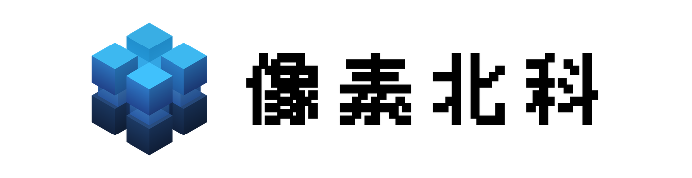
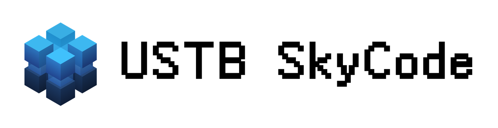

# SkyCode 全新统一视觉形象规范

本仓库收录**北京科技大学学生天码智能社**的统一视觉标识、像素字标及三维预览。社团只有**唯一一种 Logo 图形**：由八个立方体及内部支撑构成的立体标志。下列版本共用同一图形结构，按名称与背景选择相应字标和配色。

含文本的 Logo 分为两类，使用范围以标识对象为准：

- **像素北科**：用于“像素北科平台”“像素北科项目”以及“像素北科项目成果”，包括网站、项目介绍、成果展示和相关宣传材料。
- **USTB SkyCode**：用于“天码智能社”社团标识，包括社团介绍、对外宣传、活动物料及演示文稿中的社团署名。

## 标识版本与使用场景

表格左侧均为 PNG 预览；为便于在 GitHub 的不同主题下辨认，预览图附带对应的浅色或深色背景。右侧链接指向背景透明的 PNG 与 SVG 成品，实际使用时优先选用 SVG，需位图时使用 PNG。

| 标识预览（PNG） | 名称、用途与适用背景 |
| :---: | :--- |
|  | **唯一图形标志 · 蓝色 Logo** 用于头像、图标、独立图形展示，以及名称已由周围文字明确说明的场景。保留原有蓝色渐变、立体明暗和半透明结构。 [PNG](logo.png) · [高清 PNG](logo-3200.png) · [SVG](logo.svg) |
|  | **像素北科 · 蓝字** 用于像素北科平台、项目及项目成果。适合白色或浅色背景，作为完整彩色标识；文字自上而下随 Logo 渐变。 [PNG](logo-zh-blue.png) · [SVG](logo-zh-blue.svg) |
|  | **像素北科 · 黑字** 用于像素北科平台、项目及项目成果。适合白色或浅色背景，文字需保持清晰、中性的场景。图形仍为蓝色。 [PNG](logo-zh-black.png) · [SVG](logo-zh-black.svg) |
|  | **像素北科 · 白字** 用于像素北科平台、项目及项目成果。适合黑色、深色背景，或有足够对比度的深色图片区域。图形仍为蓝色。 [PNG](logo-zh-white.png) · [SVG](logo-zh-white.svg) |
|  | **像素北科 · 白图白字** 用于像素北科平台、项目及项目成果。适合深色 PPT、深色页脚，以及需要整体白色标识的深色背景。图形通过灰阶明暗保留立体感。 [PNG](logo-zh-white3d.png) · [SVG](logo-zh-white3d.svg) |
|  | **USTB SkyCode · 蓝字** 用于天码智能社社团标识。适合白色或浅色背景，作为社团完整彩色标识；文字自上而下随 Logo 渐变。 [PNG](logo-en-blue.png) · [SVG](logo-en-blue.svg) |
|  | **USTB SkyCode · 黑字** 用于天码智能社社团标识。适合白色或浅色背景，如社团介绍、正式文档和活动物料。图形仍为蓝色。 [PNG](logo-en-black.png) · [SVG](logo-en-black.svg) |
|  | **USTB SkyCode · 白字** 用于天码智能社社团标识。适合黑色、深色背景，或有足够对比度的深色图片区域。图形仍为蓝色。 [PNG](logo-en-white.png) · [SVG](logo-en-white.svg) |
|  | **USTB SkyCode · 白图白字** 用于天码智能社社团标识。适合深色 PPT 中的社团署名、深色页脚及整体白色的品牌露出。保留图形的光照与阴影，避免纯白平涂损失立体感。 [PNG](logo-en-white3d.png) · [SVG](logo-en-white3d.svg) |

**配色选择：** 蓝字与黑字主要用于浅色背景，白字与白图白字主要用于深色背景。“白字”“黑字”“蓝字”仅指文字颜色，图形保持蓝色；只有“白图白字”同时采用白色立体图形与白色文字。深色背景并不要求把图形改为白色，蓝色图形配白字同样是规范版本。

使用时保持原有比例、图形与文字的相对位置、像素字形及留白。不要拉伸、拆改结构、另换字体，或用纯色覆盖既有渐变与明暗；复杂图片背景上应选择对比清晰的区域。

## 蓝色 Logo 的设计思路

北京科技大学学生天码智能社的 Logo 以**北京科技大学校徽中的“鼎”元素**起手，将这一具有北科大辨识度的形象转译为体素语言：上下两层、每层四个立方体，共同构成八立方体的主体。

图形填充由明至暗的渐变“北科蓝”，结合不同朝向的明暗变化，呈现体积、层次与空间感。加粗像素字标延续体素构成方式，使图形与文字形成统一的视觉语言。

上下两层各设置**十字桥接**，并以**半透明玻璃连接结构**组织“鼎”的中轴支撑，使八个立方体形成连贯的空间整体。为保证外部轮廓简洁，内部桥接在正常展示视角下尽量被主体方块遮挡；旋转预览时，桥接与玻璃支撑逐渐显露，既能看见结构，也保留正面展示的整洁感。

从标准展示方向水平旋转约 **45°**，再将观察高度放平，即可看到下方侧视图中的“鼎”形轮廓。两列主体与中间桥接呼应校徽中“鼎”的勾边图案，让体素造型承载鲜明的北科大元素。

### 四个观察角度

正视图沿用定稿的标准轴测展示方向；稍斜视图降低观察高度并略微转动，展示内部连接；侧视图按水平正对方块侧面的方向呈现“鼎”形；顶视图则展示四方布局与十字桥接。

| 蓝色 Logo 视图（PNG） | 观察重点 |
| :---: | :--- |
|  | **正视图 · 标准展示方向** 采用定稿的轴测构图，呈现上下两层立方体、渐变蓝色与立体明暗。内部桥接尽量藏于方块之后，保持外部形象整洁。 |
|  | **稍微斜视图 · 结构显露** 略微旋转并降低视线，观察方块之间的半透明玻璃，以及正常展示方向下被遮挡的内部十字桥接。 |
|  | **侧视图 · 鼎形轮廓** 从标准展示方向水平旋转约 45° 并放平视线，两列方块、桥接与支撑共同呈现与北科大校徽中“鼎”元素相呼应的勾边轮廓。 |
|  | **顶视图 · 四方与十字** 从上方观察四个上层立方体的对称排布，以及中心十字桥接，理解主体如何构成统一的空间结构。 |

## 文件与预览

- 根目录的 `logo.svg`、`logo.png` 是标准蓝色图形；`logo-3200.png` 是高清位图。
- `logo-zh-*` 为“像素北科”字标，`logo-en-*` 为“USTB SkyCode”字标；同名 SVG 与 PNG 对应同一版本。
- [logo.html](logo.html) 为完整三维预览，[logo-viewer.html](logo-viewer.html) 为简洁嵌入版。下载到本地后，用支持 WebGL2 的浏览器打开即可旋转查看。
- [docs/images](docs/images) 存放本 README 的 PNG 预览与四角度配图；图片使用仓库内相对路径，便于在 GitHub 展示。
- [src](src) 存放制作程序与字体等资源，使用说明见 [制作程序说明](src/README.md)；运行 `node src/build_readme.cjs` 可重新生成 README 配图。
